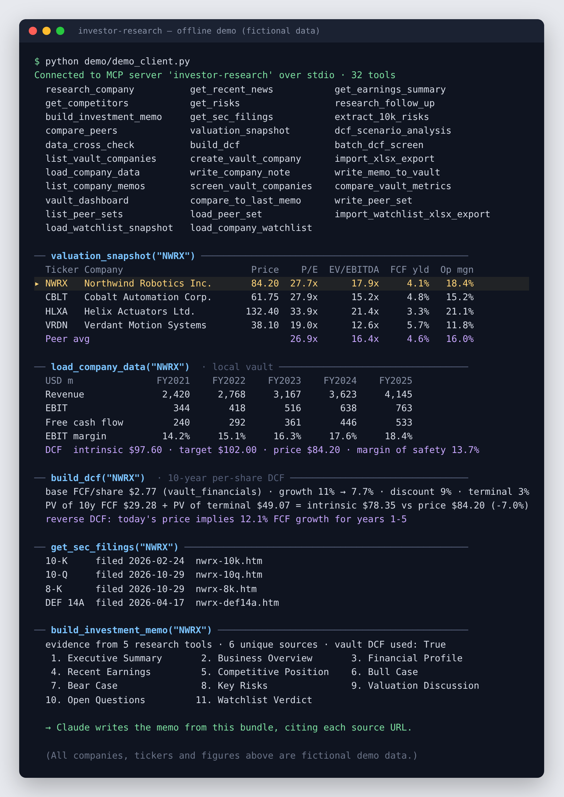

# investor-research MCP

[](https://github.com/williamhatcher4/Investment_research/actions/workflows/tests.yml)
[](LICENSE)

A production-quality [Model Context Protocol](https://modelcontextprotocol.io/)
server that connects Claude Desktop to live equity research tools. Supports
two interchangeable research backends — **Tavily** (default, cheaper) and
**Perplexity Sonar** — plus optional
[Financial Modeling Prep](https://site.financialmodelingprep.com/) data for
structured financial statements.

**Design principle:** the MCP tools gather evidence (search results + URLs
+ optional synthesized answer + structured FMP data). Claude Desktop
downstream does the analysis — distinguishing sourced facts from
interpretation and composing the final investment memo.




### Try it without API keys

```bash
pip install -r requirements.txt
python demo/demo_client.py
```

This starts the real server and talks to it over MCP stdio, the same way
Claude Desktop does. Only the outermost network calls (Tavily, FMP, SEC
EDGAR) are swapped for **fictional** data in
[`demo/fake_data.py`](demo/fake_data.py); the tool logic, local vault,
SQLite index and MCP layer are the production code. The screenshot above is
that command's real output.

---

## Tools

**Phase 1 — research:**

| Tool                       | What it returns                                                                          |
|----------------------------|------------------------------------------------------------------------------------------|
| `research_company`         | Broad evidence bundle: business model, segments, earnings, growth, margins, risks, etc.  |
| `get_recent_news`          | Material company-specific events over a trailing window (default 30 days)                |
| `get_earnings_summary`     | Most recently reported quarter: revenue, EPS, margins, guidance, market reaction         |
| `get_competitors`          | Primary public competitors, seeded by FMP peer list                                      |
| `get_risks`                | Material risks across operational / balance sheet / regulatory / macro / valuation / industry |
| `research_follow_up`       | Fresh evidence search for an arbitrary follow-up question about a ticker                 |
| `build_investment_memo`    | Bundles all five tools' evidence + an 11-section outline for Claude to fill in           |

**Phase 2 — filings + valuation + DCF:**

| Tool                       | What it returns                                                                          |
|----------------------------|------------------------------------------------------------------------------------------|
| `get_sec_filings`          | Recent 10-K / 10-Q / 8-K / proxy filings with direct EDGAR URLs (primary sources)        |
| `extract_10k_risks`        | Item 1A / 7 / 7A text pulled from the latest 10-K on EDGAR; web search only as fallback  |
| `compare_peers`            | Side-by-side rows for multiple tickers (revenue, margins, multiples, debt) + comparison  |
| `valuation_snapshot`       | Subject ticker's P/E, EV/EBITDA, FCF yield, margins, debt — plus peer-row averages (FMP peers or a saved peer set) |
| `build_dcf`                | 10-year two-stage per-share DCF with Gordon terminal value, input sanity checks, and a reverse DCF (growth implied by today's price) |
| `batch_dcf_screen`         | Runs `build_dcf` across the imported watchlist and ranks companies by upside             |
| `dcf_scenario_analysis`    | Bear/base/bull band around the workbook DCF + reverse DCF from vault free cash flow      |
| `data_cross_check`         | Flags >5% differences between vault fundamentals and FMP (revenue, net income, debt, shares) |

**Phase 3 — local research vault** (see [Local research vault](#local-research-vault)):

| Tool                         | What it does                                                                                    |
|------------------------------|-------------------------------------------------------------------------------------------------|
| `list_vault_companies`       | Enumerate companies in the local vault with sector/status frontmatter                           |
| `create_vault_company`       | Create the per-company folder tree + stub home note. Idempotent                                 |
| `import_xlsx_export`         | Copy + parse a Bloomberg/FactSet xlsx export, write normalized JSON, update SQLite index        |
| `load_company_data`          | Read the parsed `FundamentalsSnapshot` (20yr history + DCF) + frontmatter for a ticker          |
| `write_company_note`         | Write the body of the company's home note (`{TICKER}.md`); preserves YAML frontmatter           |
| `write_memo_to_vault`        | Save a generated memo to `Companies/{TICKER}/memos/` with a dated filename                       |
| `list_company_memos`         | List saved memos for a ticker, newest first                                                     |
| `compare_to_last_memo`       | Latest + previous memo excerpts with instructions for a thesis-change review                    |
| `screen_vault_companies`     | Screen companies on a metric's latest value (or a given period) against min/max thresholds      |
| `compare_vault_metrics`      | Recent history of chosen metrics side by side across tickers                                    |
| `vault_dashboard`            | Freshness, memo coverage and DCF flags for every company in the vault                            |
| `write_peer_set` / `list_peer_sets` / `load_peer_set` | Save and reuse named peer groups (`Watchlists/peer_sets.yml`)          |
| `import_watchlist_xlsx_export` | Import a multi-company watchlist scorecard workbook; fans out per-company rows               |
| `load_watchlist_snapshot` / `load_company_watchlist` | Read the whole imported watchlist, or one company's row                 |

Each Phase 1/2 tool returns:

```json
{
  "ticker": "MSFT",
  "as_of": "2026-05-18T...Z",
  "provider": "tavily",
  "query": "...",
  "answer": "Tavily's synthesized answer...",
  "results": [
    { "title": "10-Q", "url": "https://sec.gov/...", "content": "...", "score": 0.94 }
  ],
  "sources": [{ "url": "...", "title": "...", "publisher": "..." }],
  "fmp_snapshot": { "profile": { ... }, "income_statement": [...], "peers": [...] },
  "fundamentals_snapshot": {
    "source": "vault",
    "periods": ["FY2004", "...", "FY2025"],
    "series": { "revenue": [...], "ebit": [...], "free_cash_flow": [...] },
    "ratios": { "ebit_margin": [...], "roic": [...] },
    "dcf": { "intrinsic_value_per_share": 82.4, "target_price": 90.0, "margin_of_safety": 0.105 },
    "prompt_block": "Profile: ticker=NKE | sector=Consumer ..."
  },
  "notes": ["vault: parsed fundamentals available (22 periods, parsed_at=...)"]
}
```

When parsed vault data is present for a ticker, `fundamentals_snapshot.source = "vault"`
and the snapshot carries the user's own 20-year history + DCF. The original
`fmp_snapshot` block remains as a cross-check. When no vault data is present,
`fundamentals_snapshot` mirrors the FMP shape (`source = "fmp"`).

---

## Installation

Requires Python 3.11+.

```bash
python -m venv .venv
.venv/Scripts/activate            # Windows
# source .venv/bin/activate        # macOS/Linux

pip install -r requirements.txt
```

Development (tests):

```bash
pip install -r requirements-dev.txt
pytest -q
```

---

## Environment setup

Copy `.env.example` to `.env` and fill in the keys for your chosen provider.

```env
# Choose the research backend
RESEARCH_PROVIDER=tavily         # or "perplexity"

# Required when RESEARCH_PROVIDER=tavily
TAVILY_API_KEY=tvly-...

# Required when RESEARCH_PROVIDER=perplexity
PERPLEXITY_API_KEY=pplx-...

# Optional — structured statement data
FMP_API_KEY=...

# Optional overrides
LOG_LEVEL=INFO
TAVILY_SEARCH_DEPTH=advanced     # "basic" = 1 credit, "advanced" = 2 credits
PERPLEXITY_MODEL=sonar-pro

# SEC EDGAR contact User-Agent (required by SEC for programmatic access)
SEC_EDGAR_USER_AGENT=your-app-name your-email@example.com

# Local research vault — enables Phase 3 vault tools and auto-enriches Phase 1/2
# tool outputs with parsed fundamentals. Leave VAULT_ROOT unset to disable.
VAULT_ROOT=./data/Investor Research Vault
ENABLE_SQLITE=true
```

The server fails fast at startup if the chosen provider's key is missing.

### Switching providers

Just change `RESEARCH_PROVIDER` in `.env` and restart Claude Desktop. No
code edits required — both providers implement the same `search()`
interface and return the same evidence shape.

---

## Claude Desktop configuration

Add the server to your Claude Desktop MCP config
(`%APPDATA%\Claude\claude_desktop_config.json` on Windows,
`~/Library/Application Support/Claude/claude_desktop_config.json` on macOS):

```json
{
  "mcpServers": {
    "investor-research": {
      "command": "C:/path/to/Investment_research/.venv/Scripts/python.exe",
      "args": ["C:/path/to/Investment_research/server.py"],
      "env": {
        "RESEARCH_PROVIDER": "tavily",
        "TAVILY_API_KEY": "tvly-...",
        "FMP_API_KEY": ""
      }
    }
  }
}
```

Use **absolute paths**. Restart Claude Desktop. All 32 tools should
appear in the tool picker.

---

## Example prompts

> Use investor-research to build an investment memo on MSFT. Focus on
> whether it is attractive at current valuation. Separate sourced facts
> from your interpretation.

> Research NVDA, AMD, and AVGO. Compare them as long-term AI infrastructure
> investments. Use earnings, margins, valuation, and competitive risks.

> Find the biggest investment risks for TSLA over the next 24 months.

---

## How the analysis split works

Because the MCP server returns raw evidence (search snippets + an optional
synthesized answer + FMP statement data) rather than pre-structured
analysis, Claude in Claude Desktop is the structuring + reasoning engine.
That means:

- Every claim Claude makes can be traced back to a URL in `sources`.
- For `build_investment_memo`, Claude composes all 11 sections — Executive
  Summary, Business Overview, Financial Profile, Recent Earnings,
  Competitive Position, Bull Case, Bear Case, Key Risks, Valuation
  Discussion, Open Questions, Watchlist Verdict — from one bundle.
- Switching back to Perplexity later changes only the search backend; the
  tool surface and downstream prompts stay the same.

---

## Local research vault

The vault is an Obsidian-compatible folder structure that stores per-company
research artifacts — Bloomberg/FactSet xlsx exports, parsed JSON, generated
memos, and human notes. When configured, every Phase 1/2 tool auto-enriches
its output with the parsed fundamentals and `build_investment_memo` instructs
Claude to anchor the Valuation Discussion on the user's own DCF.

### One-time setup

```bash
# In .env
VAULT_ROOT=./data/Investor Research Vault
ENABLE_SQLITE=true

# Create the folder tree
python -m investor_research.vault init
```

This creates `Companies/`, `Sectors/`, `Watchlists/`, `Templates/`, and
`database/` under `VAULT_ROOT`. Re-running `init` is safe (idempotent).

### Folder layout

```
{VAULT_ROOT}/
├── Companies/
│   ├── NKE/
│   │   ├── NKE.md                       company home note (YAML frontmatter)
│   │   ├── bloomberg_exports/           raw xlsx files (immutable, gitignored)
│   │   │   └── 2026-05-18_CompanyHistoryBBV2.xlsx
│   │   ├── parsed/                      normalized JSON (canonical structured data)
│   │   │   ├── financials.json
│   │   │   ├── valuation.json
│   │   │   └── metadata.json
│   │   ├── memos/                       dated, generated memos
│   │   └── notes/                       ad-hoc human notes
│   └── ...
├── Sectors/                             sector overview notes
├── Watchlists/                          MD files with `tickers: [...]` frontmatter
├── Templates/                           Obsidian note templates
└── database/
    └── investor_research.sqlite         derived index (rebuildable from parsed/)
```

JSON in `parsed/` is the canonical structured store. SQLite is a derived
index used only for cross-company queries; it can always be rebuilt with
`python -m investor_research.vault reindex`. Set `ENABLE_SQLITE=false` to
skip the index entirely (single-company workflows still work).

### Adding a Bloomberg/FactSet xlsx export

From Claude Desktop, ask the model to call `import_xlsx_export`:

> Import the latest Nike Bloomberg export at
> `C:\Users\me\Downloads\CompanyHistoryBBV2 - Nike.xlsx` for ticker NKE.

Under the hood the tool will:

1. Create the `Companies/NKE/` folder tree if missing.
2. SHA-256 the source. If the same hash is already in
   `bloomberg_exports/`, the import is a no-op (`deduped: true`).
3. Copy the file into `bloomberg_exports/` with a dated prefix.
4. Parse the workbook via the field registry, write
   `parsed/financials.json`, `parsed/valuation.json`, `parsed/metadata.json`.
5. Refresh the SQLite index.

You can also drop xlsx files into `bloomberg_exports/` manually, then run:

```bash
python -m investor_research.vault reindex
```

### Example Claude prompts

> Build an investment memo on NKE using my local vault. Pull the parsed
> fundamentals via `load_company_data`, anchor the Valuation Discussion on
> the DCF target price from the vault (not web-derived multiples), then
> save the memo to the vault as `2026-05-18_investment_memo`.

> List every company in my vault and tell me which ones have a memo from
> 2026 and which are missing one.

> Update the Nike home note with a one-paragraph summary of the FY2025
> result. Preserve the existing frontmatter.

### Privacy / licensing

Bloomberg and FactSet data are proprietary. The vault treats raw xlsx
files and parsed derivatives as private:

- `bloomberg_exports/` and `parsed/` are gitignored by default.
- MCP tools surface **parsed, normalized fields** — never raw sheet
  contents or the workbook file path inline.
- You are responsible for complying with your Bloomberg / FactSet
  contractual terms. Do not push the vault to a public repository.

### Field registry (extending the parser)

The xlsx parser walks each labeled row of the `Main` sheet and looks up
the label + Bloomberg field code in
[investor_research/vault/field_registry.py](investor_research/vault/field_registry.py).
To support a new template field, add a `FieldSpec` entry — no parser
rewrite required.

---

## Project structure

```
investor-research-mcp/
├── server.py                            # FastMCP entry point (32 tools)
├── investor_research/
│   ├── config.py                        # env loading + Settings + provider selection
│   ├── tickers.py                       # shared ticker validator
│   ├── logging_setup.py                 # JSON logging + secret redaction
│   ├── models.py                        # ResearchEvidence + FundamentalsSnapshot + ...
│   ├── clients/
│   │   ├── research_provider.py         # Provider interface + factory
│   │   ├── tavily.py                    # Tavily search client
│   │   ├── perplexity.py                # Perplexity Sonar client
│   │   ├── fmp.py                       # Financial Modeling Prep client
│   │   └── sec_edgar.py                 # SEC EDGAR client (filings, ticker→CIK)
│   ├── source_quality.py                # source typing + quality tiers for citations
│   ├── prompts/                         # per-tool query templates
│   ├── tools/
│   │   ├── research.py                  # 5 Phase 1 research tools
│   │   ├── memo.py                      # build_investment_memo
│   │   ├── filings.py                   # get_sec_filings, extract_10k_risks
│   │   ├── valuation.py                 # peers, valuation, DCF + reverse DCF, batch screen
│   │   └── vault_tools.py               # vault, watchlist, peer-set and screening tools
│   └── vault/                           # Obsidian-compatible local vault
│       ├── __main__.py                  # `python -m investor_research.vault [init|reindex]`
│       ├── paths.py                     # folder layout + lifecycle
│       ├── notes.py                     # NKE.md + memos + frontmatter
│       ├── field_registry.py            # label → normalized-key mapping (extensible)
│       ├── xlsx_parser.py               # Bloomberg/FactSet workbook parser
│       ├── watchlist_parser.py          # multi-company watchlist scorecard parser
│       ├── ticker_aliases.py            # Bloomberg ticker → exchange ticker aliases
│       ├── snapshots.py                 # parsed JSON read/write + import pipeline
│       └── database.py                  # SQLite derived index
├── tests/                               # pytest unit tests with mocked clients
├── demo/                                # offline demo on fictional data (no API keys)
├── docs/demo.png                        # README screenshot
├── .env.example
├── requirements.txt
├── requirements-dev.txt
├── .github/workflows/tests.yml          # CI: pytest + tool-registration smoke test
├── LICENSE
└── README.md
```

---

## Verification

```bash
pytest -q
```

About 200 tests covering: config + provider selection, logging redaction,
Tavily / Perplexity / FMP / SEC EDGAR clients, every tool's happy / error
path, DCF math against hand calculations and reverse-DCF round trips,
10-K section extraction (including skipping the table of contents), the
Bloomberg/FactSet and watchlist parsers, parsed-JSON round-trip and import
dedupe, SQLite reindex + metric screens, and vault-driven enrichment of
`research_company` + `build_investment_memo`.

Smoke test (no Claude Desktop):

```bash
python -c "import asyncio, server; print([t.name for t in asyncio.run(server.mcp.list_tools())])"
```

Should print all 32 tool names.

Live single-tool check:

```bash
python -m investor_research.tools.research MSFT
```

---

## Troubleshooting

- **"TAVILY_API_KEY is required when RESEARCH_PROVIDER=tavily"** — check
  `.env` exists and is loaded from the working directory you launched the
  server from.
- **Claude Desktop doesn't see the tools** — paths in
  `claude_desktop_config.json` must be absolute. Fully quit and reopen
  Claude Desktop (not just close window).
- **Tavily credits exhausted** — switch `TAVILY_SEARCH_DEPTH=basic` (1
  credit per search instead of 2), or switch to Perplexity by setting
  `RESEARCH_PROVIDER=perplexity` and adding `PERPLEXITY_API_KEY`.
- **FMP rate limits** — the free tier is 250 requests/day. Each tool call
  uses up to 6 FMP requests. Unset `FMP_API_KEY` to skip FMP.

---

## Status

32 tools wired:

- **Phase 1 (7):** research, follow-ups and memo composition with Tavily/Perplexity + FMP.
- **Phase 2 (8):** SEC EDGAR filings and 10-K section extraction, peer
  valuation, a per-share DCF with reverse DCF, batch DCF screening, and
  vault-vs-FMP data checks.
- **Phase 3 (17):** Obsidian-compatible local vault — Bloomberg/FactSet xlsx
  ingestion, parsed-JSON store, SQLite cross-company index, memo-to-vault
  round-trip. Existing Phase 1/2 tools auto-merge parsed vault fundamentals
  when present and `build_investment_memo` anchors valuation on the user's
  own DCF rather than re-deriving from the web. Also watchlist scorecard
  import, saved peer sets, metric screens, a coverage dashboard and
  memo-to-memo thesis reviews.

---

## License

[MIT](LICENSE). Bloomberg/FactSet data you import is subject to your own
vendor terms and is not covered by this license.
